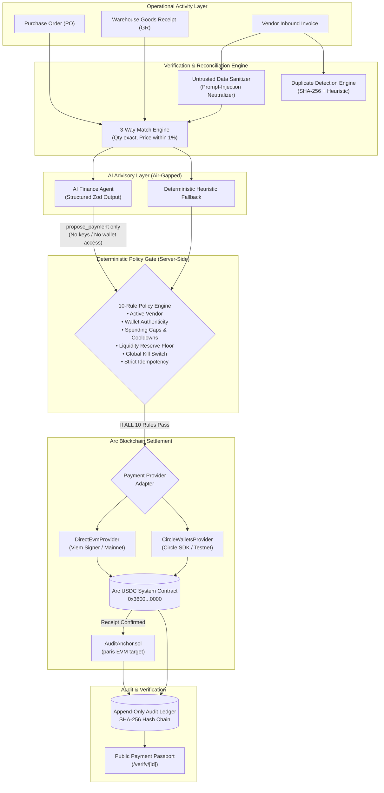

# BizFlow Pilot

> **The AI Finance Agent That Never Holds The Keys.**  
> *Turning verified business activity into policy-approved USDC payments on Arc, with tamper-evident audit proofs.*

Built for the **Arc Microgrants Hackathon (DoraHacks)** — 12-14 October 2026.

[](https://www.typescriptlang.org/)
[](https://nextjs.org/)
[](https://arc.network)
[](LICENSE)

---

## Architecture Overview



---

## Key Features

1. **Activity-to-Payment Proof Chain:** Purchase order, warehouse receiving slip, invoice, liquidity position, agent recommendation, policy result, Arc transaction, and anchor proof are bound in a tamper-evident cryptographic chain.
2. **Ironclad Air-Gap Security:** The AI agent can only propose actions. It never receives private keys, never interfaces with wallets, and cannot bypass the deterministic policy engine.
3. **Prompt-Injection Neutralization:** Invoice text is quarantined as untrusted data. Heuristic pattern filters block adversarial attempts to reroute funds.
4. **Deterministic 3-Way Reconciliation:** Mathematical matching of PO vs Goods Receipt vs Invoice. Quantities must match physically; unit prices are verified against a 1.00% policy tolerance.
5. **Provider-Agnostic Arc Settlement:**
   - **Arc Mainnet (Chain ID 5042):** Settled via `DirectEvmProvider` with a server-held EOA signer executing USDC transfers to system contract `0x3600000000000000000000000000000000000000`.
   - **Arc Testnet (Chain ID 5042002):** Settled via `CircleWalletsProvider` using Circle's Developer-Controlled Wallets SDK.
6. **Arc Dual-Decimal Protection:** Branded TypeScript types (`UsdcAtomic` 6dp vs `NativeGasAtomic` 18dp) prevent mixing native gas units and token units.
7. **Public Payment Passport (`/verify/[id]`):** A no-login, shareable verification certificate showing hashes, policy checks passed, amounts, and Arc block explorer links.
8. **Policy Simulator:** An interactive sandbox to test "what-if" scenarios (price hikes, wallet tampering, kill-switch halts) with zero side effects.

---

## Network Modes & Arc Specifications

| Parameter | Arc Mainnet | Arc Testnet |
|---|---|---|
| **Chain ID** | `5042` | `5042002` |
| **Native Gas Currency** | USDC (18 decimals via `eth_getBalance`) | USDC (18 decimals via `eth_getBalance`) |
| **USDC ERC-20 Contract** | `0x3600000000000000000000000000000000000000` (6dp) | `0x3600000000000000000000000000000000000000` (6dp) |
| **Primary RPC** | `https://rpc.mainnet.arc.io` | `https://rpc.testnet.arc.network` |
| **Fallback RPC** | `https://rpc.arc.network` | `https://rpc.testnet.arc.io` |
| **Block Explorer** | `https://explorer.arc.io` | `https://testnet.arcscan.app` |
| **Settlement Adapter** | `DirectEvmProvider` (Viem) | `CircleWalletsProvider` (Circle SDK) |

---

## Quickstart Guide

### 1. Prerequisites
- Node.js 18+ (tested on Node.js v20+)
- npm or pnpm

### 2. Clone and Install
```bash
git clone https://github.com/your-username/bizflow-pilot.git
cd bizflow-pilot
npm install
```

### 3. Configure Environment Variables
Copy `.env.example` to `.env`:
```bash
cp .env.example .env
```
Default parameters are pre-configured for local testing and Arc Testnet simulation.

### 4. Setup Database & Seed Demo Data
```bash
# Push Prisma schema to local SQLite database
npx prisma db push

# Seed the 4 test cases (Valid PO, Duplicate, Qty Mismatch, Prompt Injection)
npx tsx prisma/seed.ts
```

### 5. Run Automated Tests
```bash
npm test
```
Executes all 27 unit tests across money arithmetic, 3-way matching, duplicate screening, 10-rule policy engine, AI agent sanitizer, and cryptographic hash chain verification.

### 6. Start Development Server
```bash
npm run dev
```
Open [http://localhost:3000](http://localhost:3000) to access the **Command Center**.

---

## 10-Rule Deterministic Policy Engine

| Rule Code | Policy Rule | Enforced Action |
|---|---|---|
| `RULE_VENDOR_ACTIVE` | Approved & Active Vendor Verification | **Block** if suspended or unwhitelisted |
| `RULE_WALLET_AUTHENTICITY` | Destination Wallet Match & Cooldown | **Block** if address altered; **Review** if cooldown active |
| `RULE_3WAY_MATCH` | Three-Way Reconciliation Match | **Review** if quantities or unit prices mismatch |
| `RULE_INTEGRITY_CHECK` | Duplicate Screen & Injection Defense | **Block** if duplicate score >= 90% or hostile injection detected |
| `RULE_SPENDING_LIMITS` | Per-Payment & Daily Spending Caps | **Block** if invoice exceeds vendor limit or daily cap |
| `RULE_APPROVAL_THRESHOLD` | High-Value Human Approval Sign-off | **Review** if invoice exceeds threshold without sign-off |
| `RULE_RESERVE_PROTECTION` | Post-Settlement Liquidity Reserve | **Review** if post-payment balance dips below operating floor |
| `RULE_MAINNET_GUARD` | Arc Mainnet Safety Cap & Confirmation | **Block** if mainnet amount > 1.00 USDC without confirmation modal |
| `RULE_KILL_SWITCH` | Global Emergency Kill Switch | **Block** immediately halts all settlements |
| `RULE_IDEMPOTENCY` | Strict One-Time Settlement Idempotency | **Block** prevents duplicate transaction hashes |

---

## Smart Contract: `AuditAnchor.sol`

Compiled with `evmVersion: "paris"` to guarantee compatibility with Arc Network and avoid the `PUSH0` opcode.

```solidity
function anchor(bytes32 invoiceHash, bytes32 decisionHash, bytes32 paymentRef) external
```
- Emits `Anchored(invoiceHash, decisionHash, paymentRef, msg.sender, timestamp)`
- Prevents replay attacks by reverting if an `invoiceHash` has already been anchored.

---

## Security Model & Limitations

- **Keys Air-Gapped:** Private keys and Circle entity secrets reside exclusively in server-side memory.
- **Zero Hallucination Settlement:** The LLM cannot authorize or initiate payments directly.
- **Scope Boundary:** Multi-currency FX, payroll, and speculative yield protocols are intentionally omitted to focus on high-assurance accounts payable.
- **Mainnet Cap:** Default mainnet payments are capped at `1.00 USDC` (`MAX_MAINNET_PAYMENT_USDC`) for demonstration safety.

---

## License

MIT License. Designed and engineered for the Arc Microgrants Program (DoraHacks).
